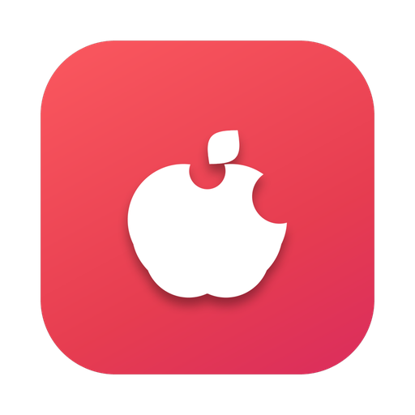
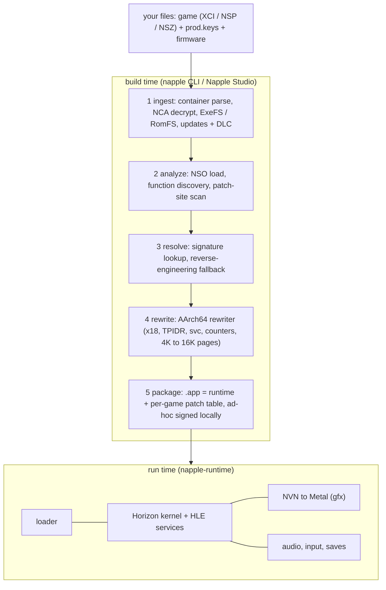

<div align="center">

<h1>&nbsp;Napple</h1>

**Turn a Switch game you own into a native Apple Silicon app.**

Ahead-of-time ARM64 rewrite · Horizon HLE · NVN → Metal · no emulator, no JIT


[](LICENSE)

[](.github/workflows/tests.yml)

</div>

---

## What is this?

The Switch and every Apple Silicon Mac are both ARM64. So instead of emulating the console, Napple **runs the game's own machine code natively** and
rewrites, ahead of time, only the few things macOS forbids: the reserved `x18` register, the thread-pointer register, `svc` system calls and the
timer-counter registers. Everything the game asks the console OS for is answered by a Horizon high-level-emulation runtime, and the GPU API (NVN)
is translated to Metal.

The result is a **standalone, locally signed `.app`** built from your own copy of the game. No JIT is needed, which also keeps the door open for iOS/iPadOS.



Per-game knowledge lives only in **data** (signatures, patch tables), never in per-game code branches. Napple is meant to be game-agnostic.

## Highlights

- **Native speed.** Guest code executes directly on the CPU; there is no interpreter or recompiler at run time.
- **Horizon kernel + HLE services.** Threads, scheduling, memory, sessions and IPC, plus a broad set of system services, with offline answers for the online ones.
- **NVN → Metal.** A GPU layer with a Maxwell shader-ISA translator, NVN pipeline and format support, MSAA, indirect draws, query objects and more.
- **Audio and input.** Audio renderer (reverb, delay, compressor, limiter, Opus) over Core Audio; GameController input with rumble, keyboard and mouse mapping.
- **Saves, updates and DLC.** Save data lives in `~/Library/Application Support/Napple/<titleId>`. Base game, updates and DLC packs are merged in any container, in any order.
- **Napple Studio.** A small SwiftUI app: drop a game on the window, watch the pipeline run, install the result.
- **Compatibility matrix.** Every game and every pipeline stage is tracked with evidence, see [`COMPATIBILITY.md`](COMPATIBILITY.md).

## Legal, up front

- You need to **own the game** and supply **your own `prod.keys` and firmware**. Nothing is downloaded, bundled or committed. Ever.
- Keys, firmware and game files are needed **only at build time**. The produced app is self-contained, but it contains game-derived content, so it is **for your personal use only**. Napple does not condone sharing builds.
- The repository contains no game bytes, keys or firmware. The compatibility matrix is metadata only.
- Napple is not affiliated with or endorsed by Nintendo.

## Status

Napple is early and moving fast. This is the state of the four titles used for testing, taken from [`docs/titles/README.md`](docs/titles/README.md)
(measured by scripted runs on an Apple Silicon Mac; a title is only called "played" where a person did) and [`docs/architecture/ios.md`](docs/architecture/ios.md):

| Title | macOS | iOS Simulator | Details |
|---|---|---|---|
| Link's Awakening (LAS) | plays, ~58 fps headless, 60 fps live | title screen | [LAS](docs/titles/01006BB00C6F0000.md) |
| Super Mario Odyssey (SMO) | plays, 60 fps live | start menu | [SMO](docs/titles/0100000000010000.md) |
| Animal Crossing: New Horizons (ACNH) | boots through the opening and shows its picture (stopgap present), ~30 fps | stops before the first frame | [ACNH](docs/titles/01006F8002326000.md) |
| Mario Kart 8 Deluxe (MK8D) | update + DLC runs races at 40-47 fps | stops (colour attachment limit / `time:u`) | [MK8D](docs/titles/0100152000022000.md) |

Nothing has run on a physical iPhone or iPad yet ([`docs/architecture/ios.md`](docs/architecture/ios.md)). Each title page lists what is still open. Per-stage results are in the
[compatibility matrix](COMPATIBILITY.md); symptoms and fixes are in [`docs/symptoms.md`](docs/symptoms.md).

The table below is an **estimate of how much of the Switch platform surface the pipeline and runtime cover** (not per-game compatibility), produced by the `%Analysis` scanner:

| Area | Coverage |
|---|---|
| CPU: AOT A64 rewrite | 100% |
| Loader: NSO / NRO / modules / relocations | 100% |
| Kernel: svcs + scheduling | 99% |
| IPC: HLE service coverage | 97% |
| IPC: command depth (implemented vs. stubbed) | 45% |
| GPU: Maxwell shader ISA | 81% |
| GPU: NVN API surface | 81% |
| GPU: formats + pipeline features | 83% |
| Audio | 94% |
| Input | 99% |
| Content: containers, crypto, updates, DLC | 91% |
| Saves + storage | 100% |
| Library applets | 48% |
| Video / media decode | 61% |
| **Overall** | **≈ 87%** |

Coverage is not compatibility: a long tail of command depth, shader corner cases and GPU behaviour is exactly what real games trip over first.

## Download

Every commit to `main` publishes a release (`.github/workflows/release.yml`): **Napple-Studio.dmg** (drag to Applications; Studio sets up the engine and
`NAPPLE_HOME` / `NAPPLE_CLI` on first launch) and **Napple-macOS-arm64.zip** (Studio + `bin/` + `install.sh`). Landing page source: `site/` (GitHub Pages via `pages.yml`).

## Quick start

> Requires an Apple Silicon Mac, Xcode command line tools, a Rust toolchain (2024 edition), and your own keys and game.

```sh
# 1. build the toolchain
cargo build --release -p napple-cli
make -C runtime            # Horizon runtime
make -C packaging          # launcher

# 2. (optional) the GUI
studio/build_app.sh        # → studio/dist/NappleStudio.app

# 3. use the CLI
target/release/napple ingest <game.xci|.nsp|.nsz> -k prod.keys
target/release/napple plan   <game> -k prod.keys
target/release/napple decomp <game> -k prod.keys -o out/ --updates latest --dlc all
```

Or just open **Napple Studio**, give it your keys once, and drop a game onto the window.

Run the tests:

```sh
cargo test                 # Rust core
make -C runtime test test-services  # runtime, on macOS
make -C runtime test-host  # portable kernel / loader / service tests, any POSIX host
```

## Repository layout

| Path | What lives there |
|---|---|
| `crates/` | Rust workspace: `napple-core` (containers, NCA crypto, content/update/DLC), `napple-rewrite` (AArch64 rewriter), `napple-sigs` (signatures), `napple-build` (`.app` packaging), `napple-compat` (matrix tooling), `napple-cli` (the `napple` command) |
| `runtime/` | loader, Horizon kernel, HLE services (C, with the Mach/Cocoa parts in Objective-C) |
| `gfx/` | NVN to Metal, Maxwell shader translator, texture layouts |
| `audio/` · `input/` · `frontend/` | audio renderer, controllers, windowing and settings overlay |
| `studio/` | Napple Studio (SwiftUI) and its packaging assets (dmg, icons) |
| `packaging/` | the app launcher placed inside every produced `.app` |
| `compat/` | compatibility data (`matrix.json`); `COMPATIBILITY.md` is generated from it |
| `knownSignatures/` | shared signature data used by the resolve stage |
| `docs/` | architecture, formats, protocols, per-title notes and per-change notes |
| `site/` | landing page (GitHub Pages, `pages.yml`) |
| `tools/` | build, test and diagnostic scripts, see [`tools/README.md`](tools/README.md) (`dev/` drivers, `legacy/` leftovers) |
| `.github/` | CI workflows, issue and pull request templates, Dependabot, CODEOWNERS |

Start with [`docs/architecture/overview.md`](docs/architecture/overview.md). Service coverage is listed in [`docs/architecture/runtime-services.md`](docs/architecture/runtime-services.md).

## Contributing

Issues, compatibility reports and pull requests are welcome: see [`CONTRIBUTING.md`](CONTRIBUTING.md), [`CODE_OF_CONDUCT.md`](CODE_OF_CONDUCT.md) and
[`SECURITY.md`](SECURITY.md). Compatibility results should name the stage, the evidence and the services or NVN calls that were missing.
Please never attach game files, keys or firmware, to an issue or anywhere else. Notable changes are listed in [`CHANGELOG.md`](CHANGELOG.md).

## FAQ

**Is this an emulator?** No. The guest's ARM64 code runs directly on the CPU after an ahead-of-time rewrite of the few instructions macOS forbids; the console OS and GPU API are
re-implemented (HLE, NVN to Metal). See [`docs/architecture/overview.md`](docs/architecture/overview.md).

**Does it include games, keys or firmware?** No, never. You supply your own, and only the build step needs them.

**Which games work?** The four titles in the status table are the ones under test; the rest is unknown. Napple is game-agnostic, but only those four have been run.

**Does it run on Intel Macs, Windows or Linux?** The product targets Apple Silicon Macs. The Rust crates and the portable tests also build on Linux (CI and `tools/linux-check/`),
but the runtime, graphics and Studio are macOS-only.

**Does it run on iPhone or iPad?** The iOS build compiles and runs on the iOS Simulator (LAS reaches its title screen, SMO its menu); it has never been run on a device. See [`docs/architecture/ios.md`](docs/architecture/ios.md).

**Why is my game slow or glitchy?** Check [`docs/symptoms.md`](docs/symptoms.md) and the title page, then open a compatibility report.

## Credits and license

Napple stands on the shoulders of open projects: audio renderer formats and effect algorithms adapted from **Ryujinx.Audio**, and runtime structure and controller
approaches adapted from **MacNativeGames** (MIT; an earlier project from the same lineage, whose full history is kept at the git tag `archive/legacy-projects-2026-10`), both MIT. Full notices are in [`THIRD_PARTY_NOTICES.md`](THIRD_PARTY_NOTICES.md) (and
[`gfx/THIRD_PARTY_NOTICES.md`](gfx/THIRD_PARTY_NOTICES.md)) and must be kept with any distribution.

Napple is released under the MIT license, see [`LICENSE`](LICENSE). Copyright (c) 2026 Eros J. Talevi.
