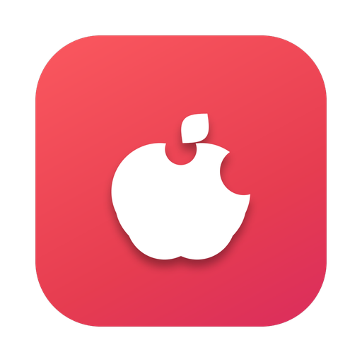

<div align="center">

<h1>&nbsp;Napple</h1>

**An ahead-of-time recompiler and runtime that turns a Switch game you own into a native Apple Silicon app.**

[](LICENSE)


[](.github/workflows/tests.yml)

</div>

> [!IMPORTANT]
> **Legal notice.** Napple is an independent project. It is not affiliated with, endorsed by or sponsored by Nintendo.
> It contains no Nintendo code, keys, firmware or games. To use it you must own the console and the games and supply your own legitimately dumped
> keys, firmware and titles; Napple never downloads game content, keys or firmware and circumvents nothing for you. Do not use it for piracy, and do not share what it builds.
> Its optional online features talk only to Napple-run servers and never contact Nintendo's. Full text: [Legal](#legal).

## What it is

Napple is a toolchain, not an emulator. The Switch and every Apple Silicon Mac both run ARM64 code, so Napple keeps the game's own machine code,
rewrites ahead of time the few instructions macOS does not allow, and links the result against a runtime that re-implements the console's operating
system services and graphics API on macOS. The output is a standalone, locally signed `.app` (or an iOS / iPadOS app) built from your own copy of a game.

It has three parts:

- **`napple` CLI** (Rust, `crates/`): ingest, analysis, rewrite and packaging.
- **Runtime** (C and Objective-C, `runtime/`, `gfx/`, `audio/`, `input/`, `frontend/`): loader, Horizon kernel, HLE services, NVN on Metal, audio, input and the in-game overlay.
- **Napple Studio** (SwiftUI, `studio/`): a Mac app that drives the CLI: drop a game on the window, get an app.

Napple is game-agnostic: knowledge about a specific game lives in data (signatures, patch tables), never in per-game code.

## How it works

1. **Ingest**: open XCI / NSP / NSZ / XCZ containers, decrypt NCAs with your keys, merge the base game, updates and DLC.
2. **Analyze**: load the NSO modules, read symbols and relocations, find every instruction that needs a rewrite.
3. **Resolve**: match known functions against shared signature data (`knownSignatures/`).
4. **Rewrite**: patch AArch64 code ahead of time: the reserved `x18` register, thread-pointer registers, `svc` system calls, timer counters, 4 KiB to 16 KiB pages. 32-bit code is lifted to AArch64.
5. **Package**: write the patched modules and data next to the runtime in an ad-hoc signed `.app` (or a signed iOS bundle).
6. **Run**: the loader maps the modules; a Horizon kernel and HLE IPC services answer system calls; NVN is translated to Metal with a Maxwell shader translator; audio, input, saves, applets and media decoding run on macOS frameworks.

There is no interpreter or JIT at run time. Details: [architecture overview](docs/architecture/overview.md).

## How to use

**Requirements.** An Apple Silicon Mac (Napple Studio needs macOS 26), the Xcode command line tools, a Rust toolchain (2024 edition) and
`brew install opus libvpx`. For each game: your own dump of the game (plus updates and DLC if you want them), your `prod.keys` and, for the
system fonts, your firmware.

**Build the toolchain.**

```sh
cargo build --release -p napple-cli
make -C audio && make -C input && make -C frontend && make -C gfx && make -C gfx adapter
make -C runtime
make -C packaging
studio/build_app.sh          # optional: Napple Studio -> studio/dist/NappleStudio.app
```

`tools/ci_build.sh` runs the same sequence. Prebuilt binaries: every commit to `main` publishes a release (`Napple-Studio.dmg` and
`Napple-macOS-arm64.zip`), built by [`.github/workflows/release.yml`](.github/workflows/release.yml).

**Prepare and run a title.**

```sh
target/release/napple plan  <game files or folder> -k prod.keys               # what will be built (base, updates, DLC, blockers)
target/release/napple build <game files or folder> -k prod.keys --firmware <firmware> -o ~/Apps
open ~/Apps/<Name>.app
```

Or open **Napple Studio**, add your keys and firmware once, and drop the game onto the window. iOS builds use `--target ios` with your own signing
identity. Saves live in `~/Library/Application Support/Napple/<titleId>`.

**Guides.** [Napple Studio](docs/guides/studio.md), [CLI reference](docs/reference/cli.md), [environment variables](docs/reference/environment-variables.md),
[debugging](docs/guides/debugging.md), [symptoms](docs/symptoms.md), [mods](docs/mods/README.md). Everything else is indexed in [docs/index.md](docs/index.md).

**Tests.**

```sh
cargo test --workspace
make -C runtime test test-services test-host
make -C gfx test && make -C frontend test
python3 tools/check_docs.py
```

## Online

Napple Online is optional: an account with up to 8 profiles and per-profile visibility tiers, friends and presence, end-to-end encrypted cloud saves,
an in-game Online tab, and multiplayer between Napple players through Napple-run servers. Signed out, everything works offline.
See the [Napple Online guide](docs/guides/napple-online.md) and [cloud saves](docs/guides/cloud-saves.md).

## Status

Napple is early and experimental. The `%Analysis` estimate of how much of the Switch platform surface the pipeline and runtime cover is **about 99.3%**
(2026-11-02; [coverage by feature](docs/reference/feature-support.md)). Coverage is not compatibility: what runs, per title and per pipeline stage, is in
[COMPATIBILITY.md](COMPATIBILITY.md), the [support matrix](docs/reference/support-matrix.md) and the [title notes](docs/titles/README.md).

<details>
<summary>Online support per title (generated)</summary>

<!-- online:begin -->
**Online play** is between Napple players only, through the Napple-run servers at `pretend.napple.lat`, never Nintendo's. Generated from [`compat/online.json`](compat/online.json) (last checked 2026-11-02); what each mode means and the notes per title are in [online support](docs/reference/online-support.md).

| Title | Backend | LAN | Local | Matchmaking | Race / match | Friends | Rankings | DataStore |
|---|---|:-:|:-:|:-:|:-:|:-:|:-:|:-:|
| Animal Crossing: New Horizons (ACNH) | nex | untested | untested | untested | untested | untested | - | untested |
| Link's Awakening (LAS) | none | - | - | - | - | - | - | - |
| Mario Kart 8 Deluxe (MK8D) | nex | works | broken | works | partial | partial | untested | untested |
| Super Mario Odyssey (SMO) | nex | - | - | - | - | - | untested | untested |

`-` means the game has no such mode.
<!-- online:end -->

</details>

## Contributing

Bug reports, compatibility reports and pull requests are welcome. Read [CONTRIBUTING.md](CONTRIBUTING.md) first: it has the legal rules, the
sign-off (DCO), the build and test steps and how to report a security problem privately. Never attach game files, keys or firmware to anything.
Notable changes are listed in [CHANGELOG.md](CHANGELOG.md).

## Legal

- **No affiliation.** Napple is an independent, community project. It is not affiliated with, endorsed by, sponsored by or approved by Nintendo.
  Nintendo Switch, Joy-Con, amiibo, NVN and the names of games are trademarks of their respective owners and are used here only to describe
  compatibility (nominative use).
- **No Nintendo material.** This repository contains no Nintendo code, SDK, keys, firmware, games or game assets. The runtime is written from public
  documentation, observed behaviour and permissively licensed or original code; see [THIRD_PARTY_NOTICES.md](THIRD_PARTY_NOTICES.md).
- **Your own copy only.** You must own the console and the games and dump your keys, firmware and titles yourself. Napple never downloads game content,
  keys or firmware and does not circumvent anything on its own; it only processes files you supply, on your machine. An app built by Napple contains game-derived
  content and is for your personal use only: do not distribute it. Napple does not support piracy.
- **Online.** Napple Online is a separate, optional service run by Napple. It never contacts Nintendo's servers and never asks for Nintendo account
  credentials. Its [terms](docs/legal/terms.md), [privacy policy](docs/legal/privacy.md) and [report policy](docs/legal/report-policy.md) are in
  [docs/legal/](docs/legal/README.md).
- **Takedown and copyright requests.** Use the takedown section of the [report and takedown policy](docs/legal/report-policy.md#takedown-requests-content-or-copyright)
  (`legal@napple.lat`), or contact the maintainer privately through GitHub. Content found to infringe is removed promptly.
- **No warranty.** The software is provided "as is", without warranty of any kind (see [LICENSE](LICENSE)).

## Credits

Napple builds on the work of these projects and people. Full notices, which must be kept with any distribution, are in
[THIRD_PARTY_NOTICES.md](THIRD_PARTY_NOTICES.md) and [gfx/THIRD_PARTY_NOTICES.md](gfx/THIRD_PARTY_NOTICES.md).

| Project | Author | License | Used for |
|---|---|---|---|
| [Ryujinx](https://github.com/Ryujinx/Ryujinx) (Ryujinx.Audio) | Ryujinx Team and Contributors | MIT | audio renderer formats and effect algorithms |
| MacNativeGames | MacNativeGames contributors | MIT | runtime structure (threads, gates, relocation, memory layout), audio mixer, Opus wrapper, rumble, movie decoder host |
| d2r-mobile | jhaizhou | MIT | NSO rewriter stopgap (`tools/refpy/`), gate and thread-entry assembly, texture layout and deswizzle code |
| LASRecomp | Peiikai | MIT | Maxwell shader translator base, keyboard / controller binding design |
| [nxnative](https://github.com/seedds/nxnative) | seedds | MIT | test and documentation ideas, rewriter edge cases, block-compressed render targets (designs, no code copied) |
| [envytools](https://github.com/envytools/envytools) | Red Hat Inc. and contributors | MIT | Maxwell instruction encodings (facts only) |
| [deko3d](https://github.com/devkitPro/deko3d) | fincs | zlib | texture block-linear layout |
| nvn.h | h1k421 | MIT | NVN type definitions |
| [bcdec](https://github.com/iOrange/bcdec) | iOrange | MIT / public domain | block-compressed texture decoding |
| [stb_vorbis](https://github.com/nothings/stb) | Sean Barrett | public domain / MIT | Vorbis movie audio |
| [libnx](https://github.com/switchbrew/libnx) | switchbrew | ISC | public description of HIPC / CMIF framing (no code included) |
| [libopus](https://opus-codec.org), [libvpx](https://chromium.googlesource.com/webm/libvpx) | Xiph.Org, the WebM project | BSD 3-clause | Opus and VP9 decoding (linked, not copied) |

Rust and Swift dependencies are pulled by cargo and SwiftPM under their own licenses; `unicorn-engine` (GPL-2.0) is a test-only dev-dependency loaded
dynamically and is not part of any build output.

## License

Napple is released under the [MIT License](LICENSE). Copyright (c) 2026 Eros J. Talevi. Third-party code keeps its own license, as listed above.
