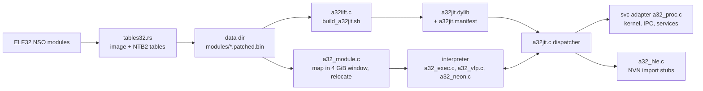

# AArch32 (32-bit titles)

Some titles (Mario Kart 8 Deluxe, `0100152000022000`) are 32-bit ARM: the NPDM flags have the 32-bit instruction set bit, the NSOs are ELF32 (`DT_REL`, ARM and Thumb-2 code).
Apple silicon cannot run AArch32, and the 64-bit path (the A64 rewriter plus native execution, see [overview](overview.md)) assumes AArch64 guest code at host addresses.
So these titles use a separate path: ELF32 packaging, a CPU core in the runtime, and an optional ahead-of-time recompiler that lifts the 32-bit code to AArch64.
No JIT is used anywhere, so the iOS rules are respected ([ios.md](ios.md)).

## Packaging
`crates/napple-build/src/tables32.rs` detects ELF32 modules (`is_elf32`) and skips the A64 rewriter: the plain image is written as `<name>.patched.bin` next to NTB2 tables.
NTB2 has the same record layout as NTB1 ([module-format.md](module-format.md)) with the magic `NTB2` and the ARM relocation kinds R_ARM_RELATIVE (23), ABS32 (2), GLOB_DAT (21) and JUMP_SLOT (22); REL addends are read from the image.
`rtld` is the entry point of these titles (their SDK has no `nn::init::Start`).

## Process layout (`runtime/src/a32/`)
- `a32_module.c`: reserves a 4 GiB guest window at a host base (macOS kills arm64 processes with a PAGEZERO smaller than 4 GiB, so guest addresses cannot be identity mapped), maps the modules from guest base 0x200000, applies the REL relocations, builds the symbol hash, resolves imports across modules and gives unresolved imports stub addresses at 0xF0000000 and above.
- `memory_init_a32` (`runtime/src/memory.c`): modules below 0x10000000, stack region at 0x10000000 (the main thread stack is placed at `MAIN_STACK` = 0x20000000 in `a32_proc.c`), heap from 0x30000000 (capped at 2 GiB), alias region above.
- `a32_proc.c`: the svc adapter. The register layout of each svc is derived from its C prototype with the algorithm of Atmosphere's svc codegen (signature table `SvcSig` in the file) and mapped onto the A64 register view the shared svc handlers take. Pointer arguments get the window base added, address results have it subtracted, 32-bit structs (QueryMemory) are converted. A guest thread is a pthread running the interpreter, so waits, futexes, IPC and services are the same code as for 64-bit guests. Each thread's thread-local region lives inside the window. The startup sequence of `rtld` is replayed on the main thread.
- `a32_hle.c` with `a32_nvn_sigs.inc` (generated by `tools/gen_a32_nvn.py` from `gfx/src/nvnapi/nvn_protos.h`): `nvnBootstrapLoader` is overridden as for 64-bit titles and every NVN entry point is a host function reached through the interpreter's `hle` hook. Arguments are marshalled with the 32-bit hard-float AAPCS. A few calls that take arrays of pointers or pointer-sized struct fields have hand-written shims.

## CPU core (interpreter)
`a32_decode_arm.c`, `a32_decode_thumb.c` decode ARM and Thumb-2 into one `A32Insn` form (IT blocks included); `a32_exec.c` executes integer code, branches, loads and stores, exclusives and the CP15 thread/counter registers; `a32_vfp.c` implements VFPv4 with ARM NaN, flush-to-zero and rounding rules; `a32_neon.c` implements Advanced SIMD. Decoded instructions are cached per CPU, keyed by pc and validated against the raw instruction bits.

Verification: `runtime/tests/a32/fuzz.py` runs one random instruction on this core and on Unicorn/QEMU from the same random state and compares registers, flags, memory, D registers and FPSCR (`pip install unicorn`). The ARMv8 additions Unicorn lacks (vsel, vmaxnm, vrint, vcvt{a,n,p,m}, lda/stl) were not compared. Host harnesses: `runtime/tests/a32/test_module.c` (loader on real data), `a32_boot.c` (mock-svc boot).

## Recompiler (`runtime/src/a32jit/`)
`a32lift.c` lifts the ARM and Thumb code to AArch64 assembly; clang builds it into an ordinary dylib, `<data dir>/modules/a32jit.dylib` with `a32jit.manifest`. Nothing is generated at run time, so the image can be signed like any dylib.
It is mixed mode: the runtime interprets anything without a lifted block, and each instruction the lifter does not handle natively (VFP, NEON, saturating and parallel arithmetic, svc, most cp15) calls the interpreter for that one instruction.
Guest r0-r14 live in host w0-w14 and the guest N, Z, C, V in the host flags; the lifter needs FEAT_FlagM (`rmif`, Apple A13 and M1 or later). Code discovery uses ELF symbols, relocated slots that point into text, init arrays, recursive branch following (including Thumb `tbb`/`tbh` and ARM `add pc,pc` tables), prologue scanning, and optional profile seeds (`a32jit.seeds`). The manifest check refuses an image built for different module bases.

Build and use:
- `tools/build_a32jit.sh <data dir>` lifts, assembles in parallel, links and installs into `<data dir>/modules`.
- `napple rewrite a32 <modules dir>` (`crates/napple-rewrite/src/a32.rs`; `build.rs` compiles the same C lifter into the crate), or `NAPPLE_A32_RECOMPILE=1 napple build ...` (`recompile_if_requested` in `crates/napple-build/src/tables32.rs`).
- Runtime switches: `NAPPLE_A32_JIT=0` disables the dylib, `NAPPLE_A32_JITSTATS=1|2`, `NAPPLE_A32_JITLOG=<file>`; debugging switches (`NAPPLE_A32_TRACE`, `NAPPLE_A32_CALLS`, `NAPPLE_A32_WATCH`, `NAPPLE_A32_NVNTRACE`, `NAPPLE_A32_DUMP`) are listed in [environment variables](../reference/environment-variables.md).

Tests (`runtime/tests/a32jit/`): `difftest` compares lifted blocks with the interpreter on random state and on instruction streams taken from real modules, `ittest` covers IT blocks, `bench` is a loop micro-benchmark. The 2026-10-25 run compared more than 600,000 samples with no mismatch and measured about 40 times the interpreter's speed on tight integer loops ([note](../archive/changes/2026-10-25-mk8d-recompiler.md)).

## Known limits
- Recorded in the notes ([core](../archive/changes/2026-10-25-aarch32-core.md), [measurements](../archive/changes/2026-10-25-aarch32-recompiler-plan.md), [recompiler](../archive/changes/2026-10-25-mk8d-recompiler.md)): NEON and `a32_neon_f32` are not fuzzed against a reference, VFP and NEON are not lifted, callbacks passed to NVN (`SetMemoryCallback`, debug callbacks) are passed as NULL, rendering into a block-compressed texture through an integer view does not copy back, and on iOS the window base differs (untested beyond the Simulator, see [ios.md](ios.md)).
- Faults inside lifted code report stale guest registers (they live in host registers x0-x14 at that moment).
- The state of MK8D (boot, update and DLC through the in-place data mode) is kept in [titles/0100152000022000.md](../titles/0100152000022000.md).
