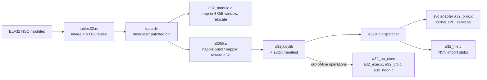

# AArch32 (32-bit titles)

Some titles (Mario Kart 8 Deluxe, `0100152000022000`) are 32-bit ARM: the NPDM flags have the 32-bit instruction set bit, the NSOs are ELF32 (`DT_REL`, ARM and Thumb-2 code).
Apple silicon cannot run AArch32, and the 64-bit path (the A64 rewriter plus native execution, see [overview](overview.md)) assumes AArch64 guest code at host addresses.
So these titles use a separate path: ELF32 packaging and an ahead-of-time lifter that translates all of the 32-bit code to AArch64 when `napple build` runs. The shipped runtime has no interpreter (since 2026-10-26); an interpreter exists only as a test oracle and behind a debug build flag.
No JIT is used anywhere, so the iOS rules are respected ([ios.md](ios.md)).

## Packaging
`crates/napple-build/src/tables32.rs` detects ELF32 modules (`is_elf32`) and skips the A64 rewriter: the plain image is written as `<name>.patched.bin` next to NTB2 tables.
NTB2 has the same record layout as NTB1 ([module-format.md](module-format.md)) with the magic `NTB2` and the ARM relocation kinds R_ARM_RELATIVE (23), ABS32 (2), GLOB_DAT (21) and JUMP_SLOT (22); REL addends are read from the image.
`rtld` is the entry point of these titles (their SDK has no `nn::init::Start`).

## Process layout (`runtime/src/a32/`)
- `a32_module.c`: reserves a 4 GiB guest window at a host base (macOS kills arm64 processes with a PAGEZERO smaller than 4 GiB, so guest addresses cannot be identity mapped), maps the modules from guest base 0x200000, applies the REL relocations, builds the symbol hash, resolves imports across modules and gives unresolved imports stub addresses at 0xF0000000 and above.
- `memory_init_a32` (`runtime/src/memory.c`): modules below 0x10000000, stack region at 0x10000000 (the main thread stack is placed at `MAIN_STACK` = 0x20000000 in `a32_proc.c`), heap from 0x30000000 (capped at 2 GiB), alias region above.
- `a32_proc.c`: the svc adapter. The register layout of each svc is derived from its C prototype with the algorithm of Atmosphere's svc codegen (signature table `SvcSig` in the file) and mapped onto the A64 register view the shared svc handlers take. Pointer arguments get the window base added, address results have it subtracted, 32-bit structs (QueryMemory) are converted. A guest thread is a pthread running the lifted image, so waits, futexes, IPC and services are the same code as for 64-bit guests. Each thread's thread-local region lives inside the window. The startup sequence of `rtld` is replayed on the main thread.
- `a32_hle.c` with `a32_nvn_sigs.inc` (generated by `tools/gen_a32_nvn.py` from `gfx/src/nvnapi/nvn_protos.h`): `nvnBootstrapLoader` is overridden as for 64-bit titles and every NVN entry point is a host function reached through the `hle` hook (lifted code branching into the import range 0xF0000000 calls it directly and continues at lr). Arguments are marshalled with the 32-bit hard-float AAPCS. A few calls that take arrays of pointers or pointer-sized struct fields have hand-written shims.

## What runs at run time
The shipped runtime contains `a32jit.c` (loads `<data dir>/modules/a32jit.dylib`, checks its manifest against the mapped modules), the kernel and service glue (`a32_proc.c`, `a32_hle.c`, `a32_module.c`) and `a32_op_exec`: the semantics of the operations the lifter does not inline (VFP, NEON, system instructions, the rarer integer forms). It does **not** contain the fetch-decode-execute loop (`a32_run`), the instruction cache or the ARM/Thumb decoders. Those are compiled only with `make -C runtime A32_INTERP=1` (`NAPPLE_A32_INTERP`), the diagnostics/oracle build, and into the host tests.
- An out-of-line operation is decoded at build time: the lifter writes the decoded `A32Insn` (plus the raw word) as read-only data next to the code and the code calls `_a32jit_fb` with its address. The runtime spills the guest registers, calls `a32_op_exec(cpu, insn)` and reloads them; nothing is fetched from guest memory and nothing is decoded. If the operation changed the pc (a load into pc, a vector register move never does) execution continues through the block table.
- A pc without lifted code (an indirect branch to an address the lifter never reached) stops the thread with `AArch32 ... stopped: no lifted code at this pc`. There is nothing to fall back to. `NAPPLE_A32_JITSTATS=1` prints a counter of such exits at the end of a run; it must read 0.
- No code is generated at run time: the only executable pages are the signed `a32jit.dylib` and the runtime itself. `tools/check_a32_no_interp.sh` proves it for a built runtime (no `a32_run` / decoder symbols, `a32_op_exec` present, no `MAP_JIT` or `PROT_EXEC` in the A32 sources, `a32jit.dylib` and its manifest present in the data directory).

## The lifter (`runtime/src/a32jit/`)
`a32lift.c` takes the relocated module images exactly as the runtime maps them (`a32_module.c`), finds the code, and writes AArch64 assembly; clang assembles it into one dylib. It runs inside `napple build` (every AArch32 title; `NAPPLE_A32_RECOMPILE=0` skips it) or as `napple rewrite a32 <modules dir> [-o work]`.

**Register convention.** Guest r0-r14 live in host w0-w14, the guest N Z C V in the host NZCV (the lifter needs FEAT_FlagM, Apple A13 or later), x19 is the instruction budget, x20 the window base, x21 the `A32Cpu *`, x22 the block table. w15-w17 and w24-w28 are temporaries. VFP/NEON registers, Q, GE, FPSCR, the exclusive monitor and TPIDR live in the `A32Cpu`.

**Memory window.** macOS kills an arm64 process whose `__PAGEZERO` is smaller than 4 GiB, so the 32-bit guest address space is a 4 GiB reservation at a host base chosen at start-up (`a32_window_init`), x20 holds it and every guest access is `[x20, wN, uxtw]`: a 32-bit offset can never leave the window, so the lifted code needs no address check. Pages the guest never mapped fault on the host; the crash handler reports them as guest faults.

**Code discovery.** Entry points: ELF function symbols, `DT_INIT`, every relocated slot that points into text (vtables, init arrays, GOT), optional profile seeds (`a32jit.seeds`, one hex address per line, bit 0 = Thumb), recursive following of direct branches and calls, and pattern recognisers for what compilers emit: Thumb `tbb`/`tbh`, ARM `add pc, pc, rX, lsl #2` branch tables, PIC switch tables (`adr rB, tab; ldr rT, [rI, rB]; add pc, rT, rB`, size from the preceding `cmp`), pc-relative function pointers (`ldr rX, [pc, #lit]; add rX, rX, pc`), `mov lr, pc` followed by a branch (return to pc + 8), jumps into the middle of unrolled division sequences (`add ip, pc, #n; sub ip, ip, rK, lsl #a; bx ip`), and prologue scanning (`push {.., lr}`). `A32LIFT_WHY=<addr>` prints what the discovery knows about an address.

**Block table.** Every entry is a label (`A_xxxxxxxx` / `T_xxxxxxxx`); direct branches inside a 32 KiB chunk are plain `b`, others go through the label. Indirect branches (`bx`, `blx`, `ldr pc`, `mov pc`, `add pc`, `tbb`/`tbh`, returns) load the target into w24 (bit 0 = Thumb) and `b _a32jit_ind`, which looks it up in an open-addressing hash table (`a32jit_hash`, 16-byte slots: guest key, code address; multiplicative hash) and `br`s to the block. A miss exits with `no lifted code at this pc`. A `bx`/`blx` to the import range 0xF0000000-0xF00FFFFF calls the host function in place (`_a32jit_hle`) and returns to lr.

**Budget and threads.** Blocks that are branch targets of backward or call edges start with `sub x19, x19, #n; tbz x19, #63` and leave the lifted code when the budget is used up, so the scheduler, `svc` waits and the crash monitor keep working. `svc` is an out-of-line operation that returns to the kernel glue.

**Conditions and IT blocks.** An instruction with a condition is emitted behind a skip branch on the host flags; branches fold the condition into the jump. The IT state is tracked at lift time (a region never starts inside an IT block), so Thumb conditional execution costs nothing at run time.

**Exclusives and barriers.** `ldrex`/`strex` families map to `ldxr`/`stxr` (`ldaex`/`stlex` to `ldaxr`/`stlxr`; the dword forms to `ldxp`/`stxp`) so the monitor semantics are the host's; `clrex` is `clrex`; `lda`/`stl` get a `dmb ishld` after / `dmb ish` before the access; `dmb`/`dsb`/`isb` (decoded as NOPs by the shared decoder; the lifter re-reads the raw word) become `dmb ish`.

**Operations that are not inlined.** Everything the lifter cannot express as a few host instructions is passed to `a32_op_exec` as described above: VFP and NEON, the rarer integer forms (saturating, parallel and halfword multiplies, `pkh`, `sat`), CP15 and system register moves, `svc`, `bkpt`/`udf` (faults). `napple rewrite a32 --coverage <modules dir>` prints how many instructions of each module are in that group, per operation, with the first address and encoding of each (the full list is `<work>/j.cov`). It prints `0 interpreter fallbacks` because the construct no longer exists; the count that matters for speed is the out-of-line total.

### Coverage on Mario Kart 8 Deluxe 1.0 (base build)
See the change note [2026-10-26-claude-a32-full-2026-10-26-macos1](../archive/changes/2026-10-26-claude-a32-full-2026-10-26-macos1.md) for the table with the numbers of the last run.

## How to add or change an instruction
1. The shared decoder (`a32_decode_arm.c` / `a32_decode_thumb.c`) must produce an `A32Insn` for it; add the op/field use to the comment table in `a32_priv.h` if it is new.
2. Semantics first: implement it in `a32_exec.c` (integer/system), `a32_vfp.c` or `a32_neon.c`. That alone makes it work (as an out-of-line operation).
3. Fuzz it against Unicorn: add the encoding class to `ARM_FAMILIES` in `runtime/tests/a32/fuzz.py` and run `python3 runtime/tests/a32/fuzz_all.py --families <name>`.
4. To inline it, add the case to `lift_insn` in `a32lift.c` (return `LIFT_NO` for operand combinations you do not handle: those stay out-of-line), then compare lifted against the oracle with `build/tests/a32/difftest --family <name>` (add the class to `FAMS` in `tests/a32jit/difftest.c`; it also takes `--from <module image>` to test real instruction streams).
5. Whole programs: drop a C file with `entry()` in `runtime/tests/a32jit/progs/` and run `python3 runtime/tests/a32jit/progtest.py` (compiles for armv7a ARM and Thumb-2 with the system clang, runs lifted and interpreted, compares with the host build).

## Verification
- `make -C runtime test-a32`: `difftest` (lifted code vs the interpreter on random instruction words and real streams, ARM and Thumb), `progtest.py`, and the no-interpreter check.
- `python3 runtime/tests/a32/fuzz_all.py` (`pip install unicorn`; a venv under a scratch directory): the interpreter/semantics core against Unicorn (QEMU 5.0) one instruction at a time on random registers, flags, VFP/NEON state and memory, all ARM families (data processing, multiplies, load/store, media, exclusives, branches, coprocessor, VFP, NEON data processing and load/store, ARMv8 additions) and random Thumb-2. It runs the families in short child processes because Unicorn dies with SIGILL on a few NEON encodings; a crash loses nothing but that sample. Documented deviations (not defects of this core): Unicorn's `vabd.s32`/`vaba.s32` wrap the difference before taking the absolute value, `vmaxnm.f64` with NaN operands returns +0, Advanced SIMD operations set cumulative FPSCR exception bits in Unicorn and not here, unpredictable encodings (pc as a destination of multiplies, `ldrd` with Rm = Rt, `vmov Sn, pc`). `fuzz.py` lists the filters with the reason next to each.
- Lifter vs interpreter vs host on whole programs: `progtest.py`.

## iOS packaging (not done; the iOS code stays isolated)
`a32jit.dylib` is an ordinary arm64 Mach-O built with `-target arm64-apple-macos13`. For iOS it has to be rebuilt with the iOS target (`-target arm64-apple-ios..`), put into the app's `Frameworks` folder and signed with the app (no JIT entitlement is needed since nothing is generated at run time), and `a32jit_init` must `dlopen` it from the bundle path instead of `<data dir>/modules`. The window base differs on iOS (a 4 GiB reservation needs the increased-memory-limit and extended-virtual-addressing entitlements). The manifest check and the out-of-line operations are unchanged. FEAT_FlagM is present on every A13 and later device.

## Known limits
- VFP and NEON are out-of-line operations (each costs a register spill/reload and a call: about 25-40 ns), correct but slow in vector-heavy loops; inline lifting of the hot NEON/VFP instructions is the next step. MK8D executes about 10 million of them per second in races.
- The image only contains code the discovery found. A computed jump to an address reached by no recogniser stops the thread; collect addresses with the `A32_INTERP=1` debug runtime and `NAPPLE_A32_JITLOG=<file>`, then rebuild with `A32LIFT_SEEDS=<file>` (or drop the file next to the modules as `a32jit.seeds`).
- Faults inside lifted code report stale guest registers (they live in host registers at that moment).
- Callbacks passed to NVN (`SetMemoryCallback`, debug callbacks) are passed as NULL; rendering into a block-compressed texture through an integer view does not copy back.
- The state of MK8D is kept in [titles/0100152000022000.md](../titles/0100152000022000.md).
