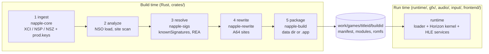
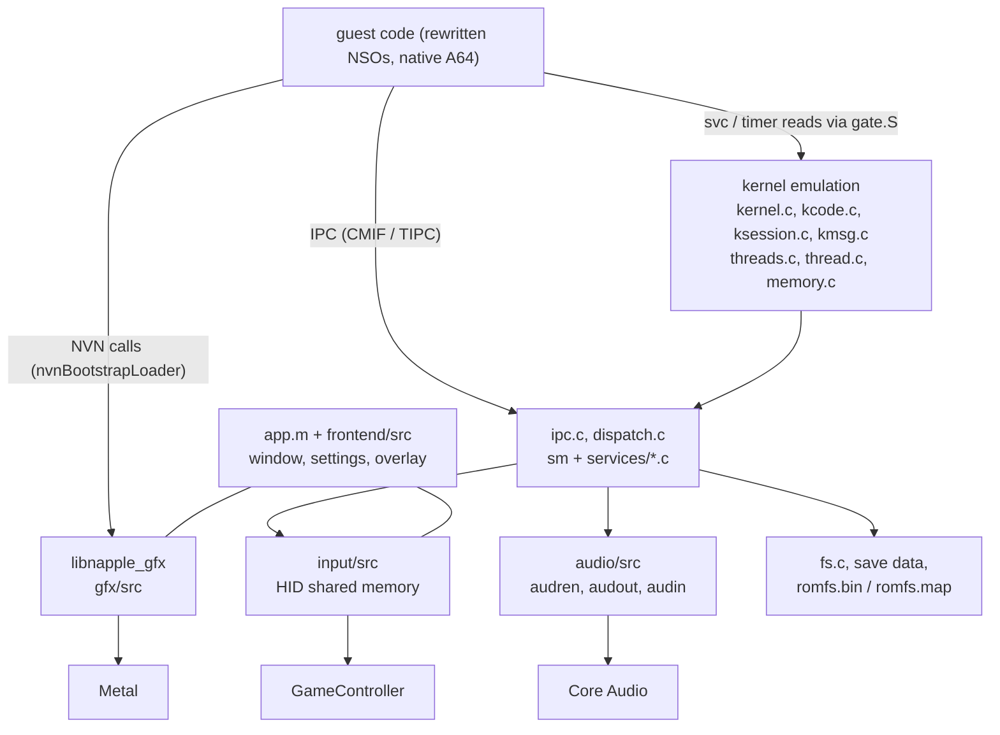

# Architecture overview

Napple turns a Switch game the user owns into a native Apple Silicon app. The Switch and every Apple Silicon Mac are ARM64, so the game's own machine code runs natively;
only what macOS forbids is rewritten ahead of time (`x18`, the thread-pointer registers, `svc`, the timer counters). Horizon services are answered by a high-level-emulation
runtime and NVN, the Switch GPU API, is implemented on Metal. There is no emulator loop and no JIT, which keeps iOS possible ([ios.md](ios.md)).
32-bit titles take a separate path ([aarch32.md](aarch32.md)).

Read this page first, then the page of the subsystem you work on. The index of all documents is [docs/index.md](../index.md).

## Pipeline

| Stage | Code | Output |
|---|---|---|
| 1 ingest | `crates/napple-core` | ExeFS (NSOs, `main.npdm`), RomFS, update (BKTR) and DLC sets, build id |
| 2 analyze | `crates/napple-core/src/analysis`, `crates/napple-rewrite/src/scan.rs` | NSO images and the list of sites to rewrite |
| 3 resolve | `crates/napple-sigs`, `knownSignatures/` | signatures per build id; unresolved items go to the REA (Ghidra) adapter |
| 4 rewrite | `crates/napple-rewrite` | `<module>.patched.bin`, `.fixups.tsv`, `.gates.tsv`, `.sites.tsv` ([rewrite-format.md](rewrite-format.md)) |
| 5 package | `crates/napple-build` | the data directory ([module-format.md](module-format.md)), optionally a signed `.app` or iOS bundle |
| compat | `crates/napple-compat`, `compat/matrix.json` | per-title, per-stage status ([compat-format.md](compat-format.md)) |

What each stage does:

1. **Ingest.** Opens XCI, NSP, NSZ and XCZ containers, decrypts NCAs with the user's `prod.keys` and the tickets in the package (NCZ bodies are decompressed back to NCA bytes),
   groups base, update and DLC packs by title id and validates them against the base. Updates are BKTR patch layers over the base RomFS and ExeFS.
2. **Analyze.** Decompresses each NSO (`main`, `rtld`, `sdk`, `subsdk*`), reads the build id, dynamic section, relocations and symbols, and scans the code for the instructions
   that cannot run as is on the host.
3. **Resolve.** Matches per-build signatures (`knownSignatures/`) for the few functions that need a name or a host override; misses can be resolved locally with the REA
   (Ghidra) adapter ([add-signatures](../guides/add-signatures.md)).
4. **Rewrite.** Replaces every `x18` use, `tpidr_el0` / `tpidrro_el0` access, `svc` and `cntpct` / `cntvct` / `cntfrq` read with a branch to a patch block (thread slots through
   the key page, host calls through the gate), gives exclusive pairs acquire/release ordering, and lays the image out for the host's 16 KiB pages. Nothing is lifted: the
   rest of the code is the game's own machine code. Unhandled sites fail the build ([rewrite-format.md](rewrite-format.md)).
5. **Package.** Writes the NTB1 tables, the data directory per version (modules, `main.npdm`, RomFS or a delta / map, DLC layers, firmware system archives and fonts,
   rewritten NROs, offline HTML), then a `.app` with the launcher and the runtime, the per-title patch table (render-scale rules, mod and fix configuration) and a local
   ad-hoc (or user identity) code signature. iOS targets get a flat bundle with the modules as Mach-O dylibs ([ios.md](ios.md)). AArch32 titles are lifted to AArch64 in this
   stage ([aarch32.md](aarch32.md)).

The CLI is `crates/napple-cli` (binary `napple`, see [CLI reference](../reference/cli.md)). Napple Studio ([studio-protocol.md](studio-protocol.md)) only calls the same CLI.

Keys, firmware and game files are needed only at build time. The produced app is self-contained and contains game-derived content, so it is for the builder's personal use.
The repository never contains game bytes, keys or firmware.

## Runtime

- **Loader and kernel** (`runtime/src/main.c`, `module.c`, `nro.c`, `ro.c`, `npdm.c`, `kernel.c`, `kcode.c`, `ksession.c`, `kmsg.c`, `thread.c`, `threads.c`, `memory.c`, `signals.c`, `gate.S`, `thread_enter.S`):
  maps the rewritten modules from the data directory, fills the key page, resolves imports in load order (`main`, `subsdk*`, `sdk`) and runs guest threads as host threads.
  Each rewritten `svc` and timer read enters the host through the gate; `svc` handlers are in the kernel files. Nothing per game is compiled into the runtime.
- **HLE services** (`runtime/src/ipc.c`, `dispatch.c`, `runtime/src/services/`): CMIF and TIPC framing, the `sm` registry and one file per service
  (`*_core.c` holds portable logic that host tests link). Coverage is listed in [runtime-services.md](runtime-services.md); network services answer like an offline console unless a network provider is configured.
  How to add one: [guide](../guides/add-ipc-service.md).
- **NVN on Metal** (`gfx/`): the NVN API surface (`api_*.c`), command recording, replay on Metal (`mtl_replay.m`), textures (`mtl_tex.m`, `tex/`), a native in-process Maxwell to MSL translator
  (`shader/maxwell_translate.c`, `mtl_shader.m`) and presentation with virtual vsync (`mtl_present.m`). See [gfx.md](gfx.md).
- **Audio** (`audio/`): audio renderer (voices, mixing, effects including I3DL2 reverb), `audout`, `audin`, Opus, output through Core Audio.
- **Input** (`input/`): writes the HID shared memory the guest reads, GameController, keyboard and mouse bindings, motion. **Frontend** (`frontend/`): window, settings, text bar, overlay.
  Interfaces between these libraries and the runtime: [audio-input-frontend.md](audio-input-frontend.md).
- **Saves and content**: save data lives under `~/Library/Application Support/Napple/<titleId>`; RomFS is a raw image or an in-place map (`romfs.map`) for development;
  DLC is served by `aoc:u` from the manifest, firmware system archives from `sysdata/` ([module-format.md](module-format.md)). Save data of the account, device, system
  and cache types is transactional (journaled commit and recovery, see [runtime-services.md](runtime-services.md)).
- **Applets.** Library applets (software keyboard, player select, controller support, error, web / offline HTML, album, network connection) are answered by built-in
  handlers that ask the frontend for a sheet when one is installed; a firmware applet (the Mii Maker by default) can run from the user's firmware in a child process.
- **Media.** The SDK movie library's VP9 and H.264 decoders are replaced by host decoders (libvpx, VideoToolbox), movie audio by Vorbis / Opus / AAC host decoders, and the
  host1x engines behind `nvdrv` (NVDEC, VIC, NVJPG, MSENC) run command streams on register-level models with VideoToolbox or a null backend.
- **AArch32.** 32-bit titles run lifted ahead of time into `a32jit.dylib`, inside a 4 GiB guest window, with an svc adapter onto the same kernel and services ([aarch32.md](aarch32.md)).
- **Network.** Every network service goes through one provider interface: the offline NullProvider by default, the built-in host provider with `NAPPLE_NET=host`, or a
  shared library ([network providers](../guides/network-providers.md)).

## Napple Studio

Studio (`studio/`) is a SwiftUI front end for the CLI: a library of built games, key and firmware setup, plan and build with progress, iOS signing and device install, and
the system data panes (Mii, amiibo, online). It never parses game files itself; it runs `napple` as a subprocess and reads the line protocol in
[studio-protocol.md](studio-protocol.md). User guide: [Studio](../guides/studio.md).

## Mods and fixes

Mods and per-title fixes are `.napmod` packages (`crates/napple-mods`): code patches (IPS, IPS32, pchtxt), RomFS file replacements served through a virtual RomFS overlay,
cheats run by a cheat VM once per frame, and configuration such as render-scale rules. They are checked against the module build ids and applied at build or launch time;
code patches are off unless enabled. See [mods](../mods/README.md).

## Napple Online (optional)

Online play is opt-in and never contacts Nintendo's servers. With `NAPPLE_NET=host` the runtime uses real sockets; with a Napple server configured, titles keep their own
online code and talk to community servers instead (default host `pretend.napple.lat`):

| Server (crate) | Role |
|---|---|
| `napple-account` | accounts with e-mail code sign-up, up to 8 profiles per account, devices, tokens, encrypted cloud-save storage (ciphertext only) |
| `napple-social` | friends, presence, visibility tiers 1-5 (`napple-visibility`) |
| `napple-online` | Napple-issued game identities and a NEX-compatible game server |
| `napple-room` | rooms that carry local wireless (LDN) and LAN play over the internet |

The client side is the runtime's network glue (`runtime/src/net/`) and `crates/napple-cloud` (Keychain secrets, end-to-end encryption of saves, sync engine), used by the
`napple` CLI and linked into the runtime.

The in-game overlay has an Online tab for the account, profiles, friends and cloud-save status. Guides: [Napple Online](../guides/napple-online.md),
[account](../guides/napple-account.md), [social](../guides/napple-social.md), [cloud saves](../guides/cloud-saves.md), [client](../guides/napple-online-client.md),
[rooms](../guides/online-rooms.md), [server deployment](../guides/deploy-servers.md).

## Source layout

| Path | Contents |
|---|---|
| `crates/` | Rust workspace: build side `napple-core`, `napple-rewrite`, `napple-sigs`, `napple-compat`, `napple-build`, `napple-mods`, `napple-cli`; servers `napple-account`, `napple-social`, `napple-visibility`, `napple-cloud`, `napple-online`, `napple-room` |
| `runtime/` | C, Objective-C and AArch64 assembly runtime (`make -C runtime`) |
| `gfx/`, `audio/`, `input/`, `frontend/` | static libraries with plain C headers (`gfx/include/napple_gfx.h` and the `include/` of each) |
| `studio/` | Napple Studio, a SwiftUI package (`NappleStudioCore` has the testable logic) |
| `packaging/` | the launcher put into built apps |
| `knownSignatures/`, `compat/` | data: signatures per build id, compatibility matrix |
| `tools/` | build, test and diagnostic scripts |
| `site/` | the landing page published on GitHub Pages |
| `docs/` | this documentation |

Platform glue (AppKit, Metal, Core Audio, GameController) stays in the `.m` files and the libraries; portable logic is plain C so it can be unit tested on Linux
(`make -C runtime test test-services test-host`).

## Design decisions

- **Native A64 with an ahead-of-time rewrite, not C lifting.** No per-game lifter, any AArch64 NSO goes through the same pipeline, and no JIT is needed. Per-game knowledge lives only in data
  (signatures, patch tables), never in code branches; the honest limit is the long tail of services and GPU features, tracked in the [compatibility matrix](../../COMPATIBILITY.md).
- **Languages.** Rust for the build side (untrusted multi-GB inputs, speed, one static binary). C, Objective-C and AArch64 assembly for the runtime, gfx, audio, input and frontend
  (guest code runs natively and the runtime talks to Metal and Core Audio directly). SwiftUI for Studio. Python only in developer tools.
- **Signatures** are data in `knownSignatures/<titleId>/<buildId>.json` ([README](../../knownSignatures/README.md)): addresses, short instruction-pattern masks, hashes, names and struct layouts, never game bytes.
  A miss is resolved by the REA adapter (`napple-sigs/src/reverser.rs`, drives Ghidra through the `rea` CLI with a hard timeout, no shell, inputs only from the work dir) and kept locally as pending.
  Sharing is opt-in, previewed byte for byte and goes through a fork and pull request (`share.rs`); nothing leaves the machine by default.
- **Updates and DLC** are selected at build time: packs are grouped by title id (base `...0000`, update `...0800`, DLC `...1xxx`) and validated against the base (application id, versions);
  BKTR patch sections are decoded over the base RomFS; every selected version gets its own rewritten ExeFS and signatures (the build id comes from the NSO header).
- **Compatibility.** The runtime exposes one interface; each title is tracked per pipeline stage in the matrix, with evidence.
- **Security.** Keys live in memory or the Keychain, never in argv, logs or the repository; temporary files are 0600 and removed. Container parsing treats input as untrusted
  (bounds and size limits, no path traversal). Signature sharing strips everything longer than the minimum pattern.
- **Baseline.** macOS 26 or later, Apple Silicon (M1 or newer), Metal; iOS and iPadOS 26 or later as AOT-only targets.
- **Reuse.** The reference projects are MIT; ideas, hash manifests and verification strategies were reused with attribution ([THIRD_PARTY_NOTICES.md](../../THIRD_PARTY_NOTICES.md)),
  Napple code is written against its own interfaces.
