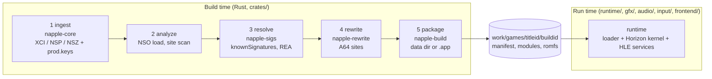
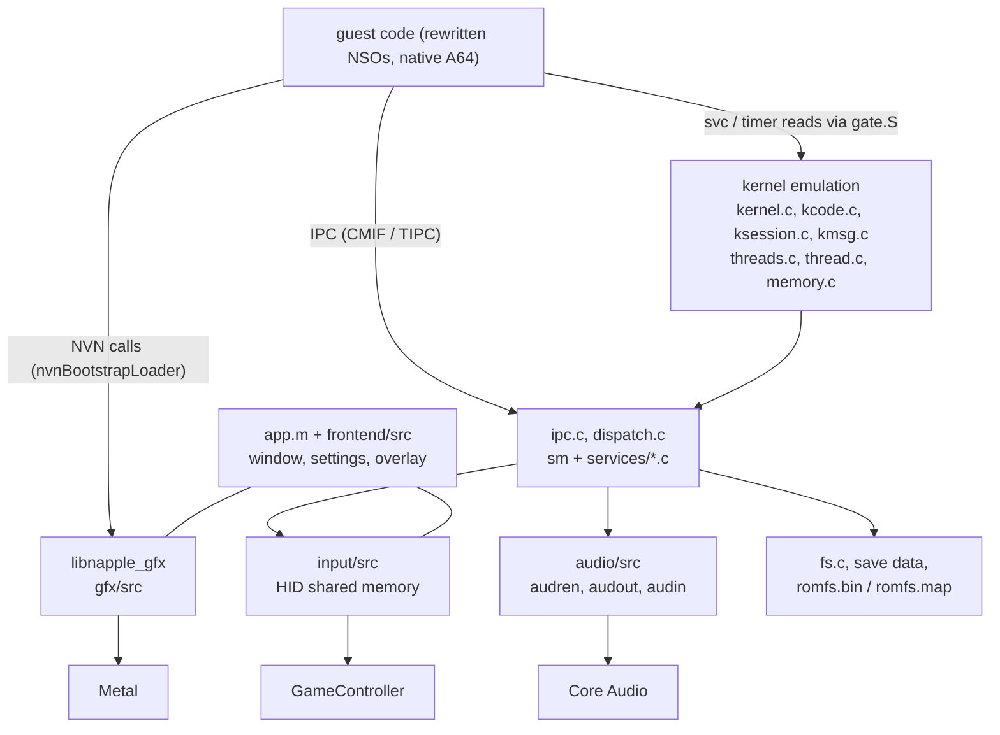

# Architecture overview

Napple turns a Switch game the user owns into a native Apple Silicon app. The Switch and every Apple Silicon Mac are ARM64, so the game's own machine code runs natively;
only what macOS forbids is rewritten ahead of time (`x18`, the thread-pointer registers, `svc`, the timer counters). Horizon services are answered by a high-level-emulation
runtime and NVN, the Switch GPU API, is implemented on Metal. There is no emulator loop and no JIT, which keeps iOS possible ([ios.md](ios.md)).
32-bit titles take a separate path ([aarch32.md](aarch32.md)).

Read this page first, then the page of the subsystem you work on. The index of all documents is [docs/index.md](../index.md).

## Pipeline

| Stage | Code | Output |
|---|---|---|
| 1 ingest | `crates/napple-core` | ExeFS (NSOs, `main.npdm`), RomFS, update (BKTR) and DLC sets, build id |
| 2 analyze | `crates/napple-core/src/analysis`, `crates/napple-rewrite/src/scan.rs` | NSO images and the list of sites to rewrite |
| 3 resolve | `crates/napple-sigs`, `knownSignatures/` | signatures per build id; unresolved items go to the REA (Ghidra) adapter |
| 4 rewrite | `crates/napple-rewrite` | `<module>.patched.bin`, `.fixups.tsv`, `.gates.tsv`, `.sites.tsv` ([rewrite-format.md](rewrite-format.md)) |
| 5 package | `crates/napple-build` | the data directory ([module-format.md](module-format.md)), optionally a signed `.app` or iOS bundle |
| compat | `crates/napple-compat`, `compat/matrix.json` | per-title, per-stage status ([compat-format.md](compat-format.md)) |

The CLI is `crates/napple-cli` (binary `napple`, see [CLI reference](../reference/cli.md)). Napple Studio ([studio-protocol.md](studio-protocol.md)) only calls the same CLI.

Keys, firmware and game files are needed only at build time. The produced app is self-contained and contains game-derived content, so it is for the builder's personal use.
The repository never contains game bytes, keys or firmware.

## Runtime

- **Loader and kernel** (`runtime/src/main.c`, `module.c`, `nro.c`, `ro.c`, `npdm.c`, `kernel.c`, `kcode.c`, `ksession.c`, `kmsg.c`, `thread.c`, `threads.c`, `memory.c`, `signals.c`, `gate.S`, `thread_enter.S`):
  maps the rewritten modules from the data directory, fills the key page, resolves imports in load order (`main`, `subsdk*`, `sdk`) and runs guest threads as host threads.
  Each rewritten `svc` and timer read enters the host through the gate; `svc` handlers are in the kernel files. Nothing per game is compiled into the runtime.
- **HLE services** (`runtime/src/ipc.c`, `dispatch.c`, `runtime/src/services/`): CMIF and TIPC framing, the `sm` registry and one file per service
  (`*_core.c` holds portable logic that host tests link). Coverage is listed in [runtime-services.md](runtime-services.md); online services answer offline.
  How to add one: [guide](../guides/add-ipc-service.md).
- **NVN on Metal** (`gfx/`): the NVN API surface (`api_*.c`), command recording, replay on Metal (`mtl_replay.m`), textures (`mtl_tex.m`, `tex/`), a native in-process Maxwell to MSL translator
  (`shader/maxwell_translate.c`, `mtl_shader.m`) and presentation with virtual vsync (`mtl_present.m`). See [gfx.md](gfx.md).
- **Audio** (`audio/`): audio renderer (voices, mixing, effects including I3DL2 reverb), `audout`, `audin`, Opus, output through Core Audio.
- **Input** (`input/`): writes the HID shared memory the guest reads, GameController, keyboard and mouse bindings, motion. **Frontend** (`frontend/`): window, settings, text bar, overlay.
  Interfaces between these libraries and the runtime: [audio-input-frontend.md](audio-input-frontend.md).
- **Saves and content**: save data lives under `~/Library/Application Support/Napple/<titleId>`; RomFS is a raw image or an in-place map (`romfs.map`) for development;
  DLC is served by `aoc:u` from the manifest, firmware system archives from `sysdata/` ([module-format.md](module-format.md)).

## Source layout

| Path | Contents |
|---|---|
| `crates/` | Rust workspace: `napple-core`, `napple-rewrite`, `napple-sigs`, `napple-compat`, `napple-build`, `napple-cli` |
| `runtime/` | C, Objective-C and AArch64 assembly runtime (`make -C runtime`) |
| `gfx/`, `audio/`, `input/`, `frontend/` | static libraries with plain C headers (`gfx/include/napple_gfx.h` and the `include/` of each) |
| `studio/` | Napple Studio, a SwiftUI package (`NappleStudioCore` has the testable logic) |
| `packaging/` | the launcher put into built apps |
| `knownSignatures/`, `compat/` | data: signatures per build id, compatibility matrix |
| `tools/` | build, test and diagnostic scripts |
| `site/` | the landing page published on GitHub Pages |
| `docs/` | this documentation |

Platform glue (AppKit, Metal, Core Audio, GameController) stays in the `.m` files and the libraries; portable logic is plain C so it can be unit tested on Linux
(`make -C runtime test test-services test-host`).

## Design decisions

- **Native A64 with an ahead-of-time rewrite, not C lifting.** No per-game lifter, any AArch64 NSO goes through the same pipeline, and no JIT is needed. Per-game knowledge lives only in data
  (signatures, patch tables), never in code branches; the honest limit is the long tail of services and GPU features, tracked in the [compatibility matrix](../../COMPATIBILITY.md).
- **Languages.** Rust for the build side (untrusted multi-GB inputs, speed, one static binary). C, Objective-C and AArch64 assembly for the runtime, gfx, audio, input and frontend
  (guest code runs natively and the runtime talks to Metal and Core Audio directly). SwiftUI for Studio. Python only in developer tools.
- **Signatures** are data in `knownSignatures/<titleId>/<buildId>.json` ([README](../../knownSignatures/README.md)): addresses, short instruction-pattern masks, hashes, names and struct layouts, never game bytes.
  A miss is resolved by the REA adapter (`napple-sigs/src/reverser.rs`, drives Ghidra through the `rea` CLI with a hard timeout, no shell, inputs only from the work dir) and kept locally as pending.
  Sharing is opt-in, previewed byte for byte and goes through a fork and pull request (`share.rs`); nothing leaves the machine by default.
- **Updates and DLC** are selected at build time: packs are grouped by title id (base `...0000`, update `...0800`, DLC `...1xxx`) and validated against the base (application id, versions);
  BKTR patch sections are decoded over the base RomFS; every selected version gets its own rewritten ExeFS and signatures (the build id comes from the NSO header).
- **Compatibility.** The runtime exposes one interface; each title is tracked per pipeline stage in the matrix, with evidence.
- **Security.** Keys live in memory or the Keychain, never in argv, logs or the repository; temporary files are 0600 and removed. Container parsing treats input as untrusted
  (bounds and size limits, no path traversal). Signature sharing strips everything longer than the minimum pattern.
- **Baseline.** macOS 26 or later, Apple Silicon (M1 or newer), Metal; iOS and iPadOS 26 or later as AOT-only targets.
- **Reuse.** The reference projects are MIT; ideas, hash manifests and verification strategies were reused with attribution ([THIRD_PARTY_NOTICES.md](../../THIRD_PARTY_NOTICES.md)),
  Napple code is written against its own interfaces.
