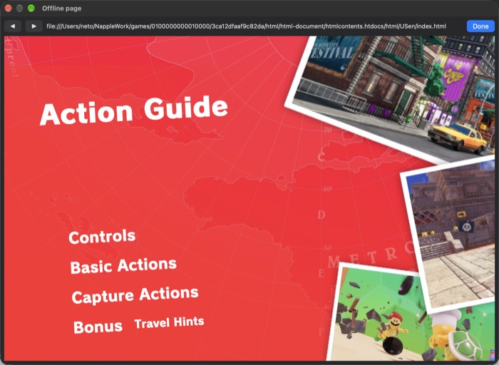

# 2026-11-01 sched-applets (batch 2026-11-01-r1, Mac)

Branch `claude/sched-applets-2026-11-01-r1`. Scheduler semantics fixed for the ACNH start flake; swkbd and the offline web applet verified on real titles.

## 1. Scheduler: two Horizon divergences fixed; the ACNH race is NOT fixed by them
### What was fixed (generic, Horizon semantics)
- **Equal-priority rotation only at priority 59.** Napple's timer preemption (kernel-threads, 2026-10-27) rotated equal-priority threads every 10 ms
  at every priority. Horizon's 10 ms timer rotates one priority per core (`KScheduler::RotateScheduledQueue` with the preemption priorities
  {59, 59, 59, 63}, mesosphere / yuzu `PreemptThreads`); threads of other priorities keep their core against an equal-priority thread until they block
  or yield. `NAPPLE_SLICE_ALL=1` restores the old rotation for comparisons.
- **A preempted thread keeps the head of its priority.** Horizon leaves a thread preempted by a better one at the front of its run queue; Napple
  re-queued it behind every equal-priority waiter (`core_put` + `core_take` with a fresh sequence). Preemption points (timer signal, svc-exit
  checkpoint, SynchronizePreemptionState) now use `core_switch`, which re-queues at the head when a better thread takes the core.
- **Main thread pinned to its ideal core** (`KThread::Initialize`: affinity = the ideal core only; it was 0x7). ACNH pins it itself at 0.96 s.
- Unit tests (`test_threads_preempt`, 12 checks): P2 rotation at 59; P5 no rotation at 47 (fails with `NAPPLE_SLICE_ALL=1`); P6 the preempted thread
  resumes before an equal-priority waiter (fails without `core_switch`, checked with a patched copy). Debug aids: `NAPPLE_THREAD_LOG` (+ core mask /
  priority changes), `NAPPLE_THREAD_STATS=1` (per-thread timer / svc-exit switches, GetCurrentProcessorNumber), `NAPPLE_PREEMPT_SIGNAL=0`.
- Measured effect (`NAPPLE_THREAD_STATS`, ACNH base, 25 s): thread 0x54 (prio 44, core 0) lost its core to equal-priority rotation 21 times with the old
  rule, 0 with the new one; other threads' counts are unchanged (better-priority preemptions).

### The ACNH base race (open)
All counts are ACNH base `7fc1baff976aeca4`, 30 s headless starts, `NAPPLE_GFX_CBTRACE=1`, run lock held one start at a time; "overlap" = a run with
recorder anomaly dumps (two threads on one command buffer).

| Runtime | Starts | Guest crashes | Runs with overlap |
|---|---|---|---|
| base-commit scheduler (`threads.c` of df2f318, same build otherwise) | 20 | 0 | 8 |
| rotation fix only | 10 | 2 (`main+0x1b61d3c` null+0x28, wild at `main+0x19c3594`) | 3 |
| final (rotation + head-of-queue) | 40 | 2 (`main+0x1b61d3c` null+0x28) | 11 |
| final, `NAPPLE_SLICE_MS=0` (no timer preemption at all) | 10 | 1 (different: null pc `main+0xabb7c` at 6 s) | 2 |
| final, `NAPPLE_PREEMPT_SIGNAL=0` | 10 | 0 | 5 |

So the overlap happens about as often with or without the scheduler changes and **also with timer preemption switched off**: the b8 observation
"0 of 60 with `NAPPLE_SLICE_MS=0`" was a small 5 s sample. Neither preemption nor equal-priority rotation is the cause. Crash counts (0-2 per series)
are too small to compare. ACNH update+DLC: 10 of 10 clean with the final runtime (and 10 of 10 with the rotation fix).

What the traces show (call chains converted to `main+` offsets from the dumps):
- The colliding threads are always the guest main thread **0x51** (core 0) and a worker, **0x57** (core 1) or **0x58** (core 2). Both run the same
  job path `job dispatcher (ret 0x19b7598) -> job item method 0x19b654c (ret 0x19b672c) -> 0x1af9960 -> 0x1b319e4 -> view vtable+0x298 = G 0x1ad9018 ->
  F 0x1ae75c0` (F binds a stack command buffer context into the shared slot `sub->array[k][bufidx]` and records). Workers enter from their loop
  (`0x19a39c4 <- 0x19a2cf8`), the main thread from the job manager (`0x19b6ea0 <- 0x1b4d164 <- 0x197a248`), which runs worker 0's share itself.
- The job is a parallel-for: the dispatcher pops a job under the worker's spinlock (`worker+0x130`), the item claim takes `[job+0xc4]..` under the job's
  spinlock (`job+0x1c`); both are ordinary `ldxr/stxr` locks, executed natively (host exclusive monitor), so the same item is not claimed twice.
- The job manager's "wait for the workers" after it kicks them (`0x19b6ed0`) does not wait: when a worker's state word `[worker+0x108]` is non-zero it
  only performs discarded loads (`ldr wzr, [xN, #0x108]`) and returns, the shape a compiler leaves of `while (state != 0) {}` on a non-atomic field.
  The update's copy (`0x390d2b0`) has the same shape, yet the update never overlaps, so this is a lead, not a proven cause: the real join of the main
  thread with the workers is elsewhere and was not found in this session.
- Ruled out: rewriter exclusive windows (`ldxr/stxr` stay native unless they contain x18), ArbitrateLock/Unlock, the condvar pair, WaitForAddress /
  SignalToAddress including modify-by-waiter-count (match mesosphere on reading), per-core data (`GetCurrentProcessorNumber` is called once per thread),
  timer preemption (table above).
Next step for whoever continues: find what makes the main thread wait for the job group before it re-records the same views (follow `0x1b4d164` /
`0x197a248` after the manager returns, and the per-job done counter `[job+0x70]` incremented by the dispatcher at `0x19b75b0`), then check the wait
primitive it uses against Horizon (and the gfx sync objects if it waits on GPU progress).

## 2. swkbd on a real title (verified)
Link's Awakening, fresh save, new file: the title needs **L+R** (A does not skip the attract movie; the title appears at about 97 s headless), then
A on an empty file opens the name keyboard at about 109 s:
```
applet: CreateLibraryApplet id 0x11 mode 0
applet: swkbd: header "" sub "" guide "" initial "Link" length 1..8 password 0 invalid-flags 0x12c (config ok, work buffer ok)
applet: swkbd: entered "Napple"
applet: swkbd: header "" sub "" guide "" initial "Napple" length 1..8 ...   <- the game's next call carries the answer it got back
```
`NAPPLE_VERBOSE=1` dumps the config words: header (+0x24), sub (+0xA6) and guide (+0x1A8) are all zero in LAS's KeyboardConfig, so the empty texts
are the title's own (the non-empty parse is covered by the unit tests). ACNH's name entry (reached at about 55 s on a fresh save) is the game's own
keyboard, not swkbd; SMO and MK8D open no keyboard offline. The inline keyboard therefore stays *tested* only (no title here uses it).

## 3. Offline web: a real title's manual (verified)
The build extracts HtmlDocument romfs to `<data-dir>/html/` as it is: `html-document/<name>.htdocs/html/<RegionLang>/index.html` (SMO: 12 languages,
MK8D: 13). An OfflineHtmlPage document path is relative to `html-document/` (yuzu's offline applet joins it the same way), so `web_offline_resolve`
now looks under `<root>/html-document/` first, then the root as before. New: `web_manual_path` (the manual for a RegionLang, fallback USen, EUen,
any), `web_manual_lang` (Switch language code -> RegionLang), `applet_web_open_manual` (the offline applet run with the WebArgs storages the HOME
menu pushes: shim offline, kind HTML page, document path) and the trigger `NAPPLE_OPEN_MANUAL=<secs>[:<RegionLang>]`.
SMO, windowed, `NAPPLE_OPEN_MANUAL=25 NAPPLE_SHEET_AUTO=confirm:4000 NAPPLE_SHEET_SHOT=...`:
```
applet: manual: opening htmlcontents.htdocs/html/USen/index.html (language USen) from .../3ca12dfaaf9c82da/html/html-document
applet: manual: shown, exit reason 0, last page file:///.../html/html-document/htmlcontents.htdocs/html/USen/index.html
```

None of the four titles opens the offline applet on its own in the first minutes; on a console the manual is opened from the HOME menu, which is what
the new path reproduces.

## 4. Soak tooling (`tools/soak/soak.py`)
`--lockf FILE` runs each start under `lockf -k FILE` (this batch's run lock) instead of gamelock.py; every run record counts `NAPPLE_GFX_CBTRACE`
anomaly dumps and recorder warnings (`cb_anomalies`, `rec_warnings`; an ok run with any keeps its log); the summary lists runs with anomalies;
`list` tolerates a missing version.

## Verified here (Mac)
| Check | Result |
|---|---|
| `make -C runtime GFX=napple test`, `make -C runtime test-host` | pass (`threads_preempt` 12/12, `kernel_sched` 24/24) |
| applet service tests (`test_svc_applet`, `_ae`, `_album`, `_host`, `_libs`, `_web`) | pass (86 / 52 / 63 / 539 / 263 / 179 checks) |
| ACNH base 40 x 30 s, final runtime | 38 ok, 2 guest crashes `main+0x1b61d3c`, 11 runs with overlap dumps (acceptance **not met**; see section 1) |
| ACNH update+DLC 10 x 30 s, final runtime | 10 ok, 0 overlap dumps |
| LAS / SMO / MK8D 60 s, final runtime | ok / ok / ok (3532 / 3526 / 3290 frames), 0 overlap dumps |
| swkbd on LAS (fresh save, L+R at the title) | `swkbd: entered "Napple"`, read back by the game |
| SMO manual (windowed, `NAPPLE_OPEN_MANUAL=25`) | shown, exit reason 0 (Done), screenshot above |
All game runs were headless (except the SMO manual run), audio off, under `lockf /Users/neto/NappleWork/.run.lock`, one start per lock hold.

## Files
`runtime/src/threads.c`, `runtime/tests/host/test_threads_preempt.c`, `runtime/src/services/applet.c`, `runtime/src/services/applet_web_core.{c,h}`,
`runtime/tests/test_svc_applet_web.c`, `tools/soak/soak.py`, `docs/architecture/runtime-services.md` (appended), `docs/todo.md` (ACNH start flake),
this note and its image.
