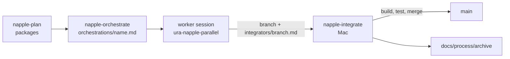

# Parallel-session workflow

Napple was built by several Claude sessions working at the same time on separate branches, then integrated onto `main` on a Mac. This page describes that process so a maintainer can run
it again. Contributors working by hand do not need it: a normal branch and pull request is fine.

## Why
The work (runtime, graphics, rewriter, docs, Studio) splits into areas that touch different files. Linux cloud sessions are good at portable logic with unit tests; only a Mac can build Metal,
Core Audio and run real games. The process lets both work in parallel without stepping on each other, and keeps an honest record of what was actually built and run.

## The pieces
| Piece | Where | Purpose |
|---|---|---|
| Orchestration file | `orchestrations/<name>.md` (git root, outside `Napple/`) | The assignment for one session: goal, owned paths, paths to avoid, environment (`mac` or `linux-cloud`), model, dependencies, acceptance list. Format: `orchestrations/TEMPLATE.md`. Written by the orchestrator, never edited by the worker. |
| Integrator file | `integrators/<branch-with-dashes>.md` | The hand-off a session writes before it stops: summary, files, what was built and tested (with evidence), what was never compiled on macOS, how to integrate, how to test, what it needs from other areas. Format: `integrators/TEMPLATE.md`. |
| Change note | [`docs/archive/changes/<date>-<branch>.md`](../archive/changes/README.md) | What changed and what is verified; added to the change archive index. |
| History | `docs/process/archive/` | Landed orchestration and integrator files (moved there from `orchestrations/done/` and `integrators/done/`). |

## Skills (in `.claude/skills/`)
- **napple-plan**: decides what to build next. It runs the coverage analysis (percent-analysis), subtracts work in flight, ranks gaps by gain per effort and packs them into parallel work packages with disjoint ownership.
- **napple-orchestrate**: takes the packages, writes one orchestration file each, launches the cloud sessions (and prepares Mac ones), tracks hand-offs and starts integration when work is ready.
- **ura-napple-parallel**: the guide every worker session follows: read its assignment, detect the environment, stay inside its owned paths, commit in small pieces (subject starts with `unbuilt:` when the code was never compiled on macOS), write the integrator file and push its branch.
- **napple-integrate**: on the Mac, reads the integrator files, builds and tests each branch, fixes small macOS-specific problems, merges one branch at a time with re-tests and moves landed files to the archive.
- **napple-latest**: clean-rebuilds everything from the latest sources into a test folder.
- **percent-analysis**: estimates how much of the Switch platform the pipeline and runtime cover and lists what is missing first.

## Rules workers follow
1. Edit only owned paths; shared files (`docs/architecture/runtime-services.md`, `COMPATIBILITY.md`, `Cargo.toml`, `Cargo.lock`, top-level Makefiles) are append-only and minimal.
2. Never push to `main`, never rewrite history; each session pushes its own branch.
3. Use honest status words: *verified* (ran here), *tested* (unit test passed), *unbuilt* (never compiled on macOS), *untested*, *proposed*. A feature that is not verified counts as partial.
4. A Linux session does not fake macOS code: portable logic gets tests, platform glue stays thin and is listed as unbuilt for the integrator.
5. Bugs found outside the owned area go into the hand-off file, not into the code.

## Lifecycle of one item

